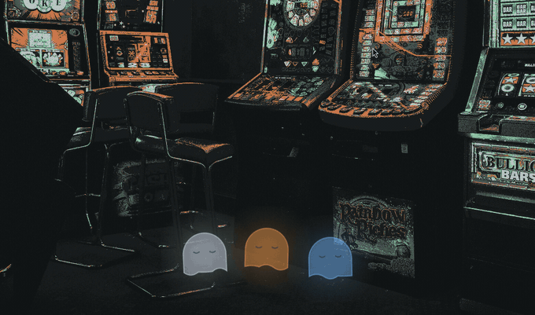

# Wisps

Wisps that haunt your desktop while your coding agents work, and drift over to
your cursor when one needs you.



Leave the terminal, keep working in another window, and you still know what
every agent is doing — they're in the corner of your eye instead of behind a
window.

## Install

```
omarchy plugin add https://github.com/Bert0424/omarchy-wisps.git
omarchy plugin enable bert.wisps
```

Then wire up the hooks below and open a new terminal.

## The states

| | |
|---|---|
| **Dozing** | No session, or one sitting idle. Faint, eyes closed, slow drift. |
| **Working** | The agent is running. Brighter, brisker bob, eyes reading. |
| **Needs you** | It's waiting on a permission or an answer — **the wisp drifts over to your cursor** and pulses. Cleared as soon as the agent gets going again. |
| **Done** | The task finished. A happy spin, then it settles back to dozing. |
| **Trouble** | The agent spent the turn flailing — three or more failed tool calls. Droops, and the colour goes sickly. |

## Several agents at once

One wisp per live session, so three projects running means a mildly haunted
desktop — and each one keeps **its own colour**, so you can see *which* agent
is asking for you rather than just that something is:

| Slot | Colour |
|---|---|
| 1st session | amber |
| 2nd | blue |
| 3rd | white |
| 4th | violet |
| 5th | green |

Both colour **and perch** are held by slot, not by row order. If one agent
exits, the others keep their colour *and stay exactly where they were* — the
gap reads honestly as "that one's gone", and the next agent to start reclaims
that spot and colour. So position identifies an agent as reliably as colour
does.

`Done` and `Trouble` override the body colour while they play. That costs
nothing now that position identifies the agent, and it means a verdict reads
the same on every wisp with nothing to learn.

### The mark it leaves

After the celebration fades, a wisp keeps a **halo** in the colour of how its
last turn ended — green for finished, red for trouble — until you send it a
new prompt. Without it, a wisp that finished six seconds ago looks identical
to one that never started: walk away for ten minutes and you can't tell which
agents succeeded, which are still thinking, and which died on a permission
prompt an hour ago.

The mark lives in the halo rather than the body on purpose. Blending the
verdict into the body turned blue into teal and amber into mud, so "finished"
stopped looking the same on every wisp. Body says *who*; halo says *what
happened*.

## Where they perch

They stay near one corner rather than roaming across whatever you're reading.
Pick **top / bottom** × **left / middle / right** in the popup, and each drifts
on a short leash of about 25px.

Corner anchors **stack vertically**, away from the corner. Middle anchors have
the whole width to use and very little height, so they **fan out sideways**
instead — centred, then alternating right and left.

## Setup

The wisp learns what your agent is doing from hooks. Claude Code and grok are
both supported, and a wisp appears per session either way — run both at once
and you get one of each.

### Claude Code

Add these to `~/.claude/settings.json` (paths assume the default plugin
location):

```json
{
  "hooks": {
    "SessionStart":     [{ "hooks": [{ "type": "command", "command": "~/.config/omarchy/plugins/bert.wisps/hooks/wisps-state.sh idle" }] }],
    "UserPromptSubmit": [{ "hooks": [{ "type": "command", "command": "~/.config/omarchy/plugins/bert.wisps/hooks/wisps-state.sh working" }] }],
    "PreToolUse":       [{ "matcher": "*", "hooks": [{ "type": "command", "command": "~/.config/omarchy/plugins/bert.wisps/hooks/wisps-state.sh busy" }] }],
    "Notification":     [{ "hooks": [{ "type": "command", "command": "~/.config/omarchy/plugins/bert.wisps/hooks/wisps-state.sh attention" }] }],
    "Stop":             [{ "hooks": [{ "type": "command", "command": "~/.config/omarchy/plugins/bert.wisps/hooks/wisps-state.sh done" }] }],
    "SessionEnd":       [{ "hooks": [{ "type": "command", "command": "~/.config/omarchy/plugins/bert.wisps/hooks/wisps-state.sh gone" }] }]
  }
}
```

Use absolute paths rather than `~` if your shell doesn't expand them. Hooks are
read when a session starts, so open a **new** terminal after adding them.

### grok

grok reads Claude-shaped hooks, so the same script drives it. Copy the bundled
template into place:

```sh
mkdir -p ~/.grok/hooks
cp ~/.config/omarchy/plugins/bert.wisps/hooks/grok-hooks.json ~/.grok/hooks/wisps.json
```

Two differences worth knowing. grok sends its payload in camelCase, which the
hook script handles — it reads `sessionId` and `$GROK_SESSION_ID` as well as
Claude's `session_id`. And grok labels its notifications, so the template
matches on `permission_prompt` and the script trusts that label instead of the
text filter described below. grok also has two events Claude lacks:
`StopFailure` maps straight to `trouble`, and `StopCancelled` (an interrupt)
returns the wisp to `idle`.

Without hooks the wisp still works — it just dozes. Everything is driven by
the state files, so any tool that writes them drives the wisp.

### GitHub Copilot CLI

Copilot CLI has the same hooks under other names. Drop this into
`~/.copilot/hooks/wisps.json` (the directory may not exist yet) and start a new
session:

```json
{
  "version": 1,
  "hooks": {
    "sessionStart":        [{ "type": "command", "bash": "~/.config/omarchy/plugins/bert.wisps/hooks/wisps-state.sh idle",      "timeoutSec": 5 }],
    "userPromptSubmitted": [{ "type": "command", "bash": "~/.config/omarchy/plugins/bert.wisps/hooks/wisps-state.sh working",   "timeoutSec": 5 }],
    "preToolUse":          [{ "type": "command", "bash": "~/.config/omarchy/plugins/bert.wisps/hooks/wisps-state.sh busy",      "timeoutSec": 5 }],
    "postToolUse":         [{ "type": "command", "bash": "~/.config/omarchy/plugins/bert.wisps/hooks/wisps-state.sh busy",      "timeoutSec": 5 }],
    "permissionRequest":   [{ "type": "command", "bash": "~/.config/omarchy/plugins/bert.wisps/hooks/wisps-state.sh pending",   "timeoutSec": 5 }],
    "notification":        [{ "type": "command", "bash": "~/.config/omarchy/plugins/bert.wisps/hooks/wisps-state.sh attention", "timeoutSec": 5 }],
    "agentStop":           [{ "type": "command", "bash": "~/.config/omarchy/plugins/bert.wisps/hooks/wisps-state.sh done",      "timeoutSec": 5 }],
    "sessionEnd":          [{ "type": "command", "bash": "~/.config/omarchy/plugins/bert.wisps/hooks/wisps-state.sh gone",      "timeoutSec": 5 }]
  }
}
```

Copilot's `preToolUse` is fail-closed: a hook that exits non-zero denies the
tool call. `wisps-state.sh` never exits non-zero and never writes to stdout, so
it is safe there and leaves the permission dialog untouched. Copilot sessions
show up as their own wisps -- the state script accepts `sessionId` as well as
`session_id`, and the poller recognises a live owner by its binary name
(`claude` or `copilot`) rather than by process name -- Copilot calls its main
thread `MainThread`.

Three Copilot habits differ from Claude Code and are handled in the scripts:

- **`permissionRequest` fires on every tool call**, granted or not. In one
  measured session it ran 29 times, nearly all waved through within
  milliseconds by an allow-all setting, while real dialogs waited 3–64 s. So
  it records `pending`, which the poller reports as attention only after it
  has sat unanswered for two seconds; `postToolUse` clears it.
- **`ask_user`** is the agent asking you a question in the terminal. A
  `preToolUse` for it is attention right away.
- **A finished subagent fires `agentStop` under its own `sessionId`.** A
  verdict for a session that never started is ignored, so subagents leave no
  phantom wisps.

Copilot's `notification` hook names its kind: `elicitation_dialog` is the
agent asking you something and flies the wisp over, `agent_idle` only reports
a finished subagent and is ignored.

### Agents on other machines

An agent you start over ssh fires its hooks on the far side, so its wisp has
to be mirrored back. On the remote machine put `wisps-state.sh`,
`wisps-poll.sh` and `wisps-verdict.py` into `~/.local/bin/bert-wisps/` and
wire `wisps-state.sh` into that machine's agent hooks exactly as above. On
this machine keep one connection per host open:

```
mkdir -p ~/.config/systemd/user
cp ~/.config/omarchy/plugins/bert.wisps/systemd/bert-wisps-remote@.service ~/.config/systemd/user/
systemctl --user enable --now bert-wisps-remote@my-server.service
```

`wisps-remote.sh` streams the remote poller's output every second into
`$XDG_RUNTIME_DIR/bert-wisps/remote/<host>.list`; the local poller merges it
while the file is under five seconds old and shows the host in front of the
directory, so the popup reads `my-server:/home/me/project`. Drop the
connection and those wisps vanish within a few seconds. Liveness is checked
on the remote side, where the pids mean something; the host must accept
key-based logins, since `BatchMode=yes` never asks for a password.

### Tests

The hook scripts are described by Gherkin scenarios in `tests/features/` and
run with [pytest-bdd](https://pytest-bdd.readthedocs.io/). No agent is
started: the "owning process" is a renamed copy of `sleep`.

```
uv run --with pytest-bdd pytest tests
```

### Why the wisp stops hovering

`Notification` is two different events wearing one name: the agent genuinely
needing a decision, and a plain nudge when the prompt has just been sitting
idle. Only the first deserves a wisp at your cursor — treating the nudge as
"needs you" left it hovering long after the work was done.

Granting a permission also fires no hook of its own, so nothing used to tell
the wisp the wait was over until the whole turn ended. `PreToolUse` now calls
the hook with `busy`: a tool starting proves the agent isn't waiting on you.
It is deliberately weaker than `working` — it only ever rescues the attention
state, never overwrites a `done` or `trouble` the wisp is still playing, and
doesn't rewrite anything on a normal tool call.

The nudge filter matches on the notification text, and the last message
received is kept at `$XDG_RUNTIME_DIR/bert-wisps/last-notification.txt` so the
patterns can be checked against reality if it ever misfires.

### When a session dies without saying so

Closing a terminal with a window-kill (`super + w`) destroys the process
outright, so `SessionEnd` never runs and nothing tells the wisp its session is
gone. Each state file therefore records the pid of the agent process that owns
it, and the poll drops any file whose process is no longer alive. A killed
session's wisp disappears within a second.

Finding that pid is not simply `$PPID`: it is the hook's own parent under
Claude Code, but grok runs hooks below a supervisor process. The script walks
up `/proc` for the first ancestor named `claude` or `grok`, and if that finds
nothing it falls back to grok's own live-session registry at
`~/.grok/active_sessions.json`, which records a pid per session.

The liveness check reads `/proc/<pid>/comm` and requires an exact match against
the agent name recorded alongside the pid. Matching the full command line
instead gave false positives: any shell whose arguments merely mentioned a
`~/.claude` path looked like a live session.

### How "trouble" is detected

There is no error hook, and `PostToolUse` does not fire for failed tool calls —
only successful ones — so a failure never reaches a hook directly. The
transcript does record it, though: every failed call lands in the session
JSONL as a `tool_result` with `"is_error": true`.

So `Stop` treats "done" as provisional. `hooks/wisps-verdict.py` reads back
just the turn that ended and counts the failures in it. Three or more and the
wisp goes to **trouble** instead of **done**.

The threshold matters: one failed command is ordinary — a grep that matches
nothing, a test meant to fail, a probe. Several in one turn is the agent
flailing, which is the moment worth looking up at. Errors from earlier turns
are not counted.

Needs `python3` (already present on Omarchy). If it is missing, or anything at
all goes wrong reading the transcript, the verdict stays **done** — a cosmetic
plugin should never claim something broke when it cannot tell.

## Settings

Click the 👻 pill in the bar. Middle-click toggles it off.

- **Size** — Small / Medium / Large
- **Where they perch** — which corner they stay near
- **Layer** — in front of windows, on the desktop, or above everything
- **Come to the cursor when needed** — the drift-to-pointer behaviour
- **Glow**
- **Linger when idle** — keep one wisp dozing between sessions
- **Preview a state** — force a state to see how it looks with no agent running

## How it draws

There is no sprite sheet. The wisp is a `Canvas` path — a dome, a travelling
wave along the hem, and two eyes — so it scales cleanly at any size and there
are no frames to redraw. The wobble is the point rather than a mistake.

## What it does to your system

- **No network access.** Nothing is sent anywhere, ever.
- **No elevated privileges.** Nothing is asked for and nothing is needed.
- Reads your pointer position by asking `hyprctl cursorpos`, and only while a
  session is actually waiting on you. The overlay never claims pointer input,
  so it can't see your clicks or what you type.
- Session state lives in `$XDG_RUNTIME_DIR/bert-wisps/`, one small file per
  session holding a single word, a working directory, the process id of the
  session that owns it, and which agent that is. It is a runtime
  directory, so it is wiped when you log out. Stale files are cleaned up
  after 8 hours.
- Reads `/proc/<pid>/comm` and `/proc/<pid>/stat` for the agent process that
  owns a session and its ancestors, to find which process to watch and to
  notice when a session dies without saying so. Only the process name and
  parent pid are used.
- Under grok only, and only when the walk above finds nothing, it reads
  `~/.grok/active_sessions.json` — grok's own registry of live sessions — for
  the process id of the current session. The read is byte-capped and refuses
  symlinks, and nothing is written to that file.
- On `Stop` it reads the tail of that session's own transcript to count failed
  tool calls. It counts them and nothing else — no content is stored, copied,
  or sent anywhere.
- The overlay is fully click-through, and the surface is unmapped entirely
  when there is no wisp to draw.

## Licence

MIT.
